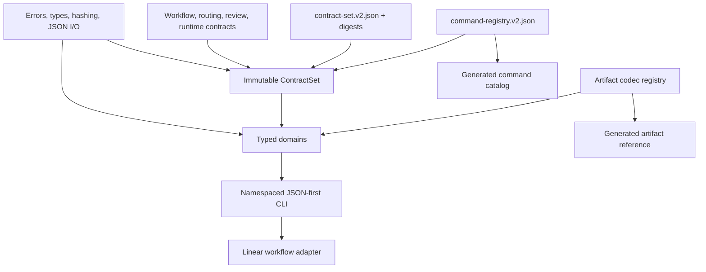
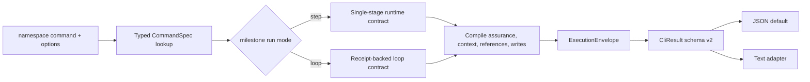
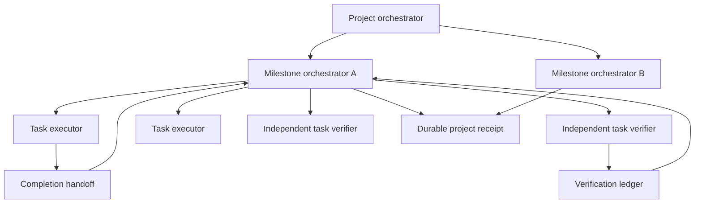

# Architecture

Linear Spanks v2 uses a one-way dependency structure: CLI adapters call domain operations; domains
consume immutable contracts and core primitives. Compatibility code exists only at the edge for v1
characterization and decoders.

## Components and sources of truth

The command registry owns path, tier, access, approval text, profiles, templates, transitions, and
legacy mappings. The contract-set index owns the exact validated contract snapshot. It is loaded
once into an immutable, injectable `ContractSet`; command compilation carries bounded policy
slices plus source/digest pointers instead of copying whole policy documents into every envelope.
The load boundary runs exhaustive characterized semantic validators against the injected in-memory
collection, so a digest-valid policy cannot weaken workflow safety literals or cross-contract
requirements. Domain calls reuse that validated snapshot without repeated file reads. The codec
registry owns durable artifact kinds and migration rules.

`compat/v1_runtime.py` is only a parser and diagnostic edge for frozen characterization. The
versioned workflow validators it calls live in owned domain modules; typed public facades and new
behavior do not depend on the compatibility edge. Effective milestone orchestration is composed
from the indexed project role, task-loop, verification-ledger, handoff, and capability policies.

## Command compilation and execution envelope

Loop-only flags are validated before compilation. Removed flat commands stop at lookup and return
their exact replacement.

## Orchestration topology

Role capability allowlists, bounded handoffs, and receipt bindings survive fresh sessions. Linear
writes, approval, lifecycle transitions, and integration remain coordinator-owned.

The architectural decision and rejected schema-engine alternative are recorded in
[ADR 0001](../architecture/adr-0001-typed-domain-modules.md).
