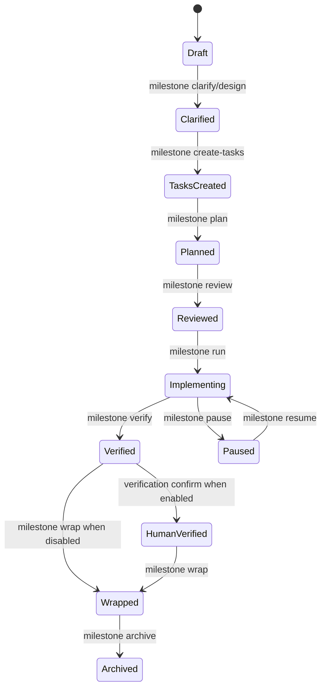
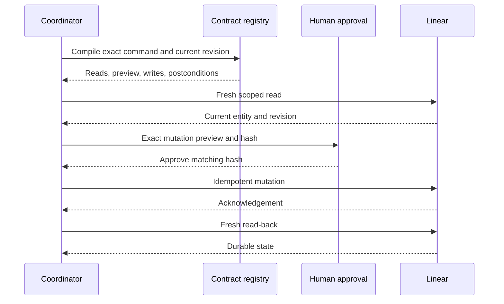

# Task-oriented usage

## Compile before acting

The executable compiles a public command into its approval, context, reference, write, and
postcondition envelope:

```bash
python3 skills/linear-spanks/scripts/linear_spanks_cli.py contracts envelope task run \
  ENG-1 --assurance balanced
```

Use `contracts brief` for the compact task-pipeline runtime card and `contracts command` for
registry metadata.

## Standard pipeline

```bash
python3 skills/linear-spanks/scripts/linear_spanks_cli.py codebase analyze /path/to/repository
python3 skills/linear-spanks/scripts/linear_spanks_cli.py project create "Outcome to deliver"
python3 skills/linear-spanks/scripts/linear_spanks_cli.py milestone clarify "Milestone outcome"
python3 skills/linear-spanks/scripts/linear_spanks_cli.py milestone create-tasks MILESTONE
python3 skills/linear-spanks/scripts/linear_spanks_cli.py milestone plan MILESTONE
python3 skills/linear-spanks/scripts/linear_spanks_cli.py milestone review MILESTONE
python3 skills/linear-spanks/scripts/linear_spanks_cli.py milestone run MILESTONE --mode step
python3 skills/linear-spanks/scripts/linear_spanks_cli.py milestone verify MILESTONE
python3 skills/linear-spanks/scripts/linear_spanks_cli.py milestone wrap MILESTONE
```

These commands compile governed work; Linear access remains subject to the installed skill,
project scope, approval, and read-back contract.

## Milestone lifecycle



## Approval, mutation, and read-back



Read commands omit the approval and mutation messages. Any revision or preview drift returns to a
new preview.

## Install and remove skills

Preview a link or copy installation before writing it:

```bash
./scripts/install-skills --client codex --scope linear --mode link --dry-run
./scripts/install-skills --client codex --scope linear --mode copy --dry-run
./scripts/install-skills --client codex --scope linear --uninstall --dry-run
```

`--scope` accepts `linear`, `exec`, `tech`, or `all`. `--client` accepts a concrete client, the
`antigravity`, `both`, or `all` aliases, and `--print-destinations` resolves the exact paths. A
single-client operation can use `--dest` for an isolated or non-default location. Link mode tracks
the checkout; copy mode creates a pinned managed snapshot. Both are transactional, replace only
entries recorded as owned, and roll back an incomplete multi-client operation. `--force` never
claims an unmanaged file.

| Client | Default skill destination | Model-routing capability |
|---|---|---|
| Codex | `$CODEX_HOME/skills` or `~/.codex/skills` | Native agent profiles |
| OpenClaude | `$OPENCLAUDE_HOME/skills` or `~/.openclaude/skills` | Namespaced settings routes |
| Claude Code | `~/.claude/skills` | Native agent profiles |
| Antigravity | CLI and IDE skill directories under `~/.gemini` | Inherits parent model |
| Kimi Code | `$KIMI_CODE_HOME/skills` or `~/.kimi-code/skills` | Advisory profiles only |
| OpenCode | `$XDG_CONFIG_HOME/opencode/skills` | Native agent profiles |

## Configure model routing

Configuration is preview-first. Provide the exact low, medium, and high identifiers supported by
the selected harness:

```bash
python3 skills/linear-spanks/scripts/configure_model_routing.py --client codex \
  --low-model model-low --medium-model model-medium --high-model model-high
python3 skills/linear-spanks/scripts/configure_model_routing.py --client codex \
  --low-model model-low --medium-model model-medium --high-model model-high \
  --dest /tmp/linear-spanks-agents --apply
```

Without `--apply`, no file is written. Codex, Claude Code, OpenClaude, and OpenCode receive managed
native configuration. Antigravity reports inherited-model behavior and Kimi reports advisory-only
behavior; neither pretends to pin a per-worker model. Existing unrelated configuration is
preserved, unmanaged namespaced collisions are refused, and a failed multi-file apply rolls back.

## Install the Caveman extension

Inspect source, bundle, mode, and destinations without network or filesystem writes:

```bash
./scripts/install-caveman --client codex --bundle core --mode link --dry-run
./scripts/install-caveman --client codex --bundle all --mode copy --dry-run
```

For an offline checkout, pass `--source-dir /path/to/caveman`; otherwise `--ref` is fetched into a
managed cache. `--cache-dir` and single-client `--dest` make both locations explicit. Apply by
removing `--dry-run`; remove only managed entries with `--uninstall`.

Before publishing anything, the installer validates the complete source tree or archive in
staging. Archives are limited to 64 MiB compressed, 256 MiB expanded, and 10,000 members, and
absolute paths, traversal, symbolic links, hard links, and special members are rejected. Cache and
destination swaps are atomic and roll back together.
