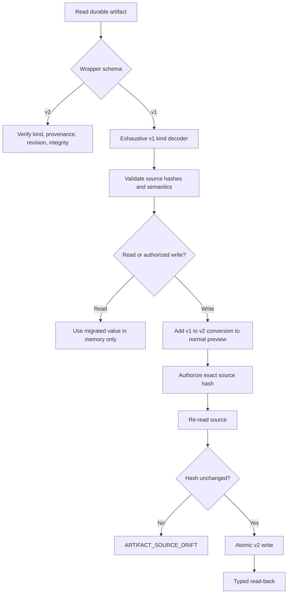

# Migrating from v1 to v2

Version 2 intentionally removes the flat public command surface. Calling a removed name returns a
structured `LEGACY_COMMAND_REMOVED` error and the exact namespaced replacement. It never invokes an
alias. The complete mapping is generated in the
[command catalog](../../skills/linear-spanks/references/command-catalog.md#removed-v1-command-mapping).

The largest command change is:

```text
run-milestone       → milestone run --mode step
run-milestone-loop  → milestone run --mode loop
run-milestone --autopilot → milestone run --mode loop
```

Step is the default. `--max-parallel`, `--resume`, `--until`, `--max-events`, and `--repair-safe`
remain loop-only and fail validation in step mode. The flat `run-milestone --autopilot` invocation
returns `LEGACY_COMMAND_REMOVED`, like every removed flat command. On the namespaced command,
`milestone run ... --autopilot` returns `LEGACY_OPTION_REMOVED` with `--mode loop` as its exact
replacement.

## Persisted artifacts

V1 artifacts remain readable; no up-front project or Linear migration is required.



V2 preserves the source payload, product/schema version, source hash, native revision, and embedded
v1 integrity fields. Repeating a migration is idempotent. Malformed and future-version artifacts
are rejected. There is no implicit bulk Linear migration.

Inspecting or previewing a filesystem artifact is explicit:

```bash
python3 skills/linear-spanks/scripts/linear_spanks_cli.py artifacts inspect state.json \
  --kind state-marker
python3 skills/linear-spanks/scripts/linear_spanks_cli.py artifacts preview state.json \
  --kind state-marker --command "task run" --target ENG-1
```

The preview returns the exact migration list, source revision tokens, `migration_preview_hash`, and
an authorization template. `artifacts migrate` accepts only a completed authorization file bound
to that command, target, preview hash, approved decision, and enclosing write receipt. It re-reads
every listed artifact and refuses drift before committing the atomic batch.

## Output and exit codes

Raw command output is replaced by a stable envelope. JSON is the default; `--format text` is a
presentation adapter. Scripts should branch on `ok` and the process exit code, then inspect
`error.code`, rather than parsing prose.
